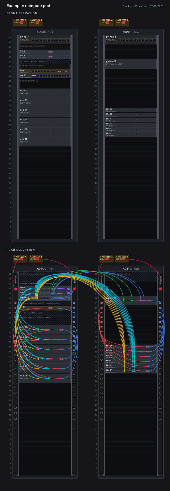

# Rack Designer

A Windows desktop app for designing server racks: lay out equipment in front and rear elevations, model power and data cabling, and check the design for overloads, single points of failure and placement mistakes.



## Features

- **Large component library**: 1,200+ components from 70+ manufacturers (Dell, HPE, Lenovo, Cisco, Juniper, Arista, Aruba, Ubiquiti, MikroTik, Fortinet, Palo Alto, NetApp, Pure, Synology, APC, Eaton, Vertiv, Raritan and more), plus generic servers, switches, PDUs, UPSs, patch panels, blanks, shelves and facility power feeds. There are also 90 rack models (enclosed, open-frame, 2-post and wall-mount).
- **Custom components and racks**: create your own devices with any mix of ports, and your own rack models, or copy a library item and adjust it. They are saved to your personal library.
- **Port arrangement**: lay out each port group with rows, numbering direction, blocks (e.g. 48 ports as 4 blocks of 6×2), alignment and position. Drag groups into place on a live faceplate preview.
- **Port colour codes**: ports are colour-coded by type (PoE, copper, management, console, SFP, QSFP, fibre, power…). You can set a custom colour per group. A legend appears on the canvas and in exports.
- **Automatic updates**: the installed app checks GitHub Releases, downloads updates when you choose, and installs them on restart.
- **Community packs**: browse, install and update packs of components and racks shared by other users (**File → Community packs…**). You can also build your own pack from your custom items and share it in a few clicks. Packs can be installed from the registry, a file, or a link. See [community/README.md](community/README.md).
- **Self-hosted registry server**: a lightweight server (port 5010) for a homelab or team. People publish packs to it directly from the app, and an admin console handles approvals. See [server/README.md](server/README.md).
- **Front and rear elevations**: full-depth vs half-depth devices, rear-mounted equipment, zero-U vertical PDUs on the side rails, and power feeds above each rack.
- **Data connections**: click a port, then another port (switch between Front and Rear mid-connection if needed). Compatibility is checked (RJ45, SFP/SFP+/SFP28, QSFP, OSFP, LC/SC/MPO fibre, console, SAS…), with notes for breakouts and copper SFPs. Cable type and length are suggested from the positions.
- **Power modelling**: facility feed → UPS → PDU → device. The model covers load splitting across redundant PSUs, per-outlet current against connector ratings, PDU/UPS/feed capacity with a configurable continuous-load limit (80% by default), 3-phase circuits, and UPS battery ride-through.
- **Failure simulation**: for every feed, shows which devices would lose power and which PDUs would be overloaded.
- **Validation**: overlaps, unpowered devices, missing PSU redundancy, overloads, port mismatches and rack weight limits. Click an issue to jump to it.
- **Files**: save/open `.rack` design files. These are self-contained JSON that embed every component definition used, so they open on any machine. You can also merge racks from another design.
- **Exports**: front and rear elevation drawings (SVG/PNG), bill of materials, cable schedule and power report (CSV).
- Undo/redo, duplicate, and keyboard shortcuts.

## Download

Get the latest Windows build from [Releases](https://github.com/KingCharlesVI/rack-designer/releases/latest):
- `rack-designer-setup-<version>.exe` installs the app and keeps it up to date (**Help → Check for updates…**).
- `rack-designer-portable-<version>.exe` runs without installing, but doesn't update itself.

The builds aren't code-signed yet, so Windows SmartScreen may warn on first run (**More info → Run anyway**).

## Getting started

Requires Node.js 20+.

```sh
npm install        # also downloads the Electron binary
npm run dev        # run with hot reload
```

Try **Help → Open example design**, or open [examples/compute-pod.rack](examples/compute-pod.rack).

| Script | Purpose |
| --- | --- |
| `npm run dev` | Run the app in development mode |
| `npm test` | Run unit tests (model, power analysis, file formats, library integrity) |
| `npm run typecheck` | Type-check everything |
| `npm run pack` | Build an unpacked Windows app in `dist/win-unpacked` |
| `npm run dist` | Build the Windows installer (NSIS) and a portable `.exe` in `dist/` |
| `npm run registry:check` | Validate the community packs in `community/packs` |
| `npm run server:build` | Bundle the registry server to `server/dist/registry-server.mjs` |
| `npm run registry:build` | Validate and regenerate `community/index.json` (CI does this on merge) |

> If you launch Electron from a VS Code terminal and it behaves like plain Node, unset `ELECTRON_RUN_AS_NODE`.

## Using it

| Action | How |
| --- | --- |
| Add a rack | Library → **Racks** tab → Add |
| Add equipment | Drag from the library onto a rack, or double-click to place it in the selected rack |
| Move a device | Drag it, or use ↑/↓ for one U at a time |
| Connect ports | Click a port, then click the other port. <kbd>Esc</kbd> cancels |
| Select a cable | Click a cable, or click a port that is already connected |
| Front/rear view | <kbd>F</kbd> / <kbd>R</kbd> |
| Show/hide cables | <kbd>C</kbd> |
| Show/hide port colour legend | <kbd>L</kbd> |
| Pan / zoom | Drag the background or scroll / <kbd>Ctrl</kbd>+scroll |
| Delete | <kbd>Del</kbd> |
| Duplicate | <kbd>Ctrl</kbd>+<kbd>D</kbd> |

Model power by placing a **power feed** (Library → Power feeds) above the rack, connecting it to a PDU's input, then connecting device PSUs to PDU outlets.

## Releasing

Releases are built on this machine and uploaded to GitHub Releases with one command:

1. Update `version` in `package.json` and add a matching `## [x.y.z]` section to [CHANGELOG.md](CHANGELOG.md). It becomes the release notes.
2. Commit and push to `main`.
3. Run `npm run release` (add `-- --dry-run` to only check and build).

The command:
- checks that `main` is clean and pushed, the version isn't already tagged, and the changelog has notes;
- asks for confirmation, then runs the type check and tests;
- builds the installer, portable `.exe` and `latest.yml`, tags the commit, and uploads everything to a new GitHub Release using the [GitHub CLI](https://cli.github.com) (`gh auth login` once).

Installed copies pick up the new version from `latest.yml` the next time they check for updates.

To change the icon, edit `build/icon.svg` (and `build/icon-small.svg` for the 16–32 px sizes), then run `npm run icons`.

## File formats

**Design (`.rack`)**: JSON with `format: "rack-designer-project"` and a `version`. It contains racks, devices (with their mount position), connections and a `components` map holding a snapshot of every component definition used.

**Library pack (`.json`)**:

```json
{
  "format": "rack-designer-library",
  "version": 1,
  "name": "My equipment",
  "components": [
    {
      "id": "acme-x1000",
      "manufacturer": "Acme",
      "model": "X1000",
      "category": "server",
      "uHeight": 1,
      "fullDepth": true,
      "power": { "typicalW": 150, "maxW": 400 },
      "ports": [
        { "id": "nic", "type": "sfp28", "count": 2, "face": "rear", "label": "P", "speed": "25G" },
        { "id": "psu", "type": "c14", "count": 2, "face": "rear", "label": "PSU" }
      ]
    }
  ],
  "racks": []
}
```

Packs shared through the community registry also carry `id`, `packVersion`, `author`, `description` and `license`. See [community/README.md](community/README.md).

Port type ids (`rj45`, `sfp+`, `qsfp28`, `lc`, `c13`, `c14`, `nema-l6-30p`, …) are listed in [src/renderer/src/model/ports.ts](src/renderer/src/model/ports.ts). Imported packs and custom components are stored in `%APPDATA%\rack-designer\library` (**File → Open library folder**).

## Library accuracy

Port layouts describe each product's base configuration. Power figures are nominal typical/maximum estimates for a common configuration. Check them against the vendor's documentation or power calculator for real capacity planning. You can override power per device in the properties panel. Products with many regional SKUs (some PDUs) are named by their electrical spec rather than a part number.

## Project layout

```
src/main/                 Electron main process (window, menu, file dialogs, user library storage)
src/preload/              Secure bridge exposed to the renderer as window.api
community/                Community pack registry (packs/*.json + generated index.json)
scripts/registry.ts       Validates community packs and builds the registry index
server/                   Self-hosted registry server (Node, no dependencies) + Docker/systemd deployment
src/renderer/src/
  model/                  Data model, placement rules, power analysis, validation, file formats, reports
  library/                Built-in component and rack library
  drawing/                Rack elevation geometry and SVG rendering (shared by canvas and export)
  components/             React UI (canvas, library, properties, bottom panel, dialogs)
  lib/                    Commands, exports, desktop API wrapper
```
